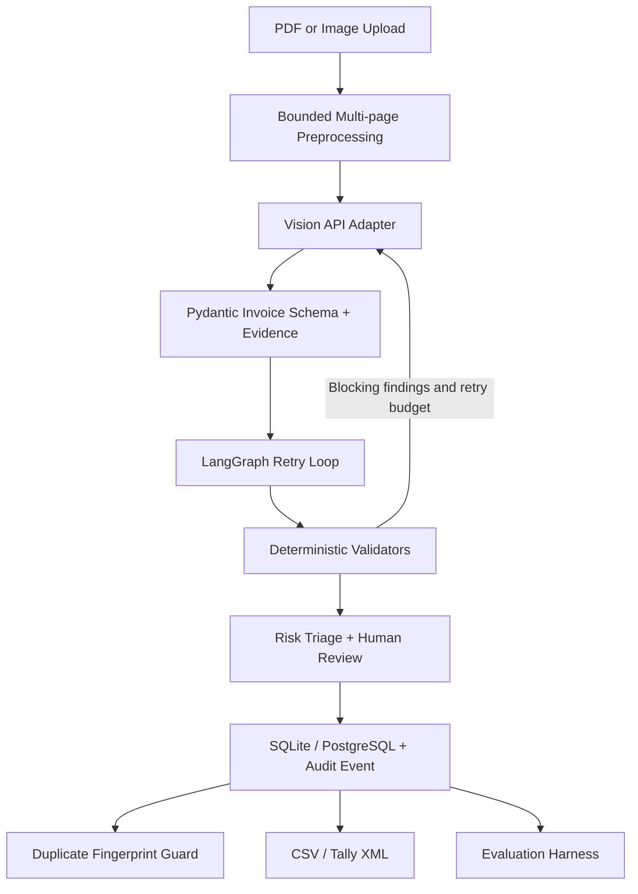

# AI-Powered Invoice Processing Agent

A research/student project for invoice extraction, deterministic validation, risk triage, human approval, audit history and accounting exports. This is not an autonomous payment or accounting authority: verify every financial field against the source document.

## Implemented workflow

- PDF/image preprocessing with bounded multi-page PDF rendering (up to 8 pages) and a single vision request containing each page.
- Configurable OpenAI-compatible vision API adapter; strict Pydantic schema, source evidence snippets and model-reported confidence hints.
- GSTIN structure and base-36 check-digit validation; line-item arithmetic, tax totals, negative amounts, mixed tax types and missing-field checks.
- LangGraph extraction/validation loop with bounded feedback retries and explicit human-review state.
- Streamlit reviewer dashboard, editable structured JSON, correction persistence, duplicate fingerprint guard, risk triage, audit events and recent-record history.
- FastAPI endpoints: `/health`, `/validate`, `/process`; upload type and 15 MiB size checks.
- SQLite local storage and PostgreSQL Compose service, CSV and minimal Tally XML export.
- Exact duplicate fingerprinting, explainable deterministic review-risk score, and field-level JSONL evaluation harness.

## Quick start (Windows PowerShell)

```powershell
py -3.11 -m venv .venv
.\.venv\Scripts\Activate.ps1
python -m pip install --upgrade pip
pip install -r requirements.txt
Copy-Item .env.example .env
```

Set `LLM_BASE_URL`, `LLM_API_KEY`, and `LLM_MODEL` in `.env`. The adapter expects `POST {LLM_BASE_URL}/chat/completions`, Bearer authentication and OpenAI-compatible `messages` with `image_url` data URLs. **Do not assume GeminiWebSocketAPI supports this contract.** Confirm the provider's documented API format first. Never commit `.env` or upload confidential invoices to an unapproved service.

Run the Streamlit reviewer:

```powershell
streamlit run ui/dashboard.py
```

Run the API in another terminal:

```powershell
uvicorn app.main:app --reload
```

API health: `http://127.0.0.1:8000/health`; interactive docs: `http://127.0.0.1:8000/docs`.

## Docker Compose

1. Copy `.env.example` to `.env` and configure the model provider.
2. Change `POSTGRES_PASSWORD` in `.env` before use outside a local demo.
3. Run `docker compose up --build`.
4. Open Streamlit on port 8501 and FastAPI docs on port 8000.

Compose starts PostgreSQL (not pgvector) and persists the database in a named volume. The current vendor suggestion is lexical similarity; **embedding-based RAG and pgvector indexing are not implemented**. SQLite has a lightweight local schema upgrade. For existing PostgreSQL deployments, use a proper migration before updating the schema.

## Evaluation

Prepare aligned JSONL files with one invoice JSON object per line:

```powershell
python evaluation/evaluate.py --predictions data/predictions.jsonl --ground-truth data/ground_truth.jsonl --tolerance 0.01
```

Report per-field accuracy and micro field accuracy on a representative, permissioned test set. Split by vendor/source where possible to avoid leakage. Report exact-match and numeric-tolerance definitions, sample count, extraction failures, validation precision/recall and human-review rate separately. Do not report results from synthetic examples as real-world model performance.

## Tests

```powershell
pytest -q
```

GitHub Actions runs the test suite on pushes and pull requests. Review the actual run status before treating a change as verified.

## Security and known limitations

- File uploads are size/type checked, but this is a demo and should not be exposed publicly without authentication, rate limiting, malware scanning and operational monitoring.
- Invoice text is untrusted input; prompt injection instructions must never be executed. Do not send sensitive documents to an unapproved provider.
- Model-reported confidence is uncalibrated and is only a review hint.
- GSTIN checksum validation is implemented locally but must be checked against authoritative test vectors before accounting production use.
- Duplicate detection currently detects exact normalized fingerprints; near-duplicate detection and cross-field fuzzy matching are not implemented.
- Risk score is a deterministic review-priority heuristic, **not** a trained fraud model or fraud probability.
- Multi-page PDFs are passed as multiple images in one request. Provider page/image limits vary; large invoices should be tested with the selected provider.
- Tally XML is a minimal export skeleton and must be integration-tested with your Tally version and ledger setup.
- No trained anomaly detector, embedding-backed retrieval, pgvector index, authentication/authorization or calibrated confidence model is included yet.

## Architecture



## Project status

Implementation has been expanded on `feature/end-to-end-invoice-agent`. A successful code commit is not proof that the provider integration or deployment works. Run CI, configure and test the actual provider contract, and evaluate against labeled invoices before using this with business records.
