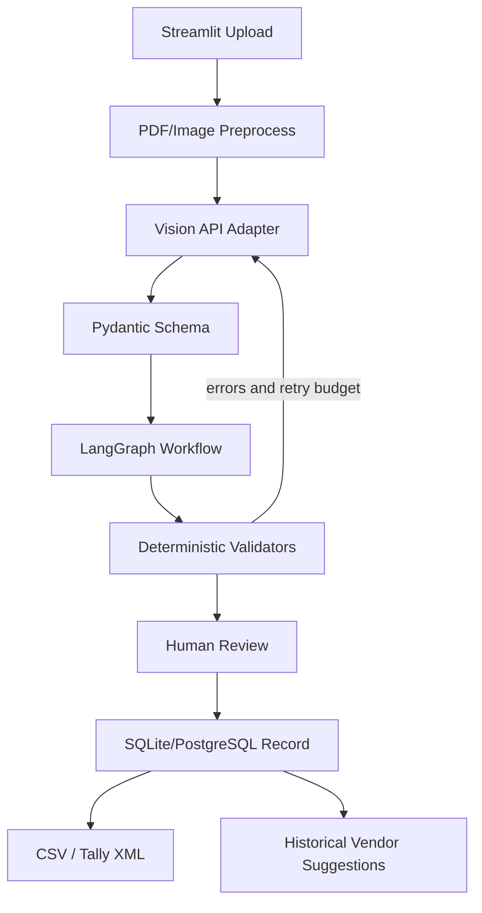

# AI-Powered Invoice Processing Agent

Invoice image/PDF extraction, deterministic validation, bounded agent workflow, human review, and accounting exports. Built as a student project; validate all results before financial use.

## Features
- PDF/image preprocessing (first PDF page rasterization, orientation normalization, contrast enhancement).
- Vision extraction through a configurable OpenAI-compatible endpoint. Configure GeminiWebSocketAPI only after confirming its exact base URL, authentication and image-input contract.
- Pydantic invoice schema and deterministic GSTIN/date/tax/total/line-item checks.
- LangGraph workflow with up to two validation-feedback extraction retries and explicit human approval.
- Streamlit dashboard, correction persistence, SQLite local default / PostgreSQL deployment option.
- CSV and minimal Tally XML export; verify XML against your Tally version and ledger setup before importing.
- Vendor similarity suggestions and an evaluation protocol.

## Quick start (Windows PowerShell)

```powershell
py -3.11 -m venv .venv
.\.venv\Scripts\Activate.ps1
python -m pip install --upgrade pip
pip install -r requirements.txt
Copy-Item .env.example .env
```

Edit `.env` with your wrapper's OpenAI-compatible chat completions URL, API key/session token and model name. The adapter currently expects `POST {LLM_BASE_URL}/chat/completions`, Bearer authentication, and OpenAI-compatible `messages` with `image_url` content. **Do not assume GeminiWebSocketAPI supports this contract.** If it does not, implement its documented request format in `app/extraction/extractor.py`. Never commit `.env` or upload real customer invoices to an unapproved service.

Run the dashboard:

```powershell
streamlit run ui/dashboard.py
```

Run the API in another terminal:

```powershell
uvicorn app.main:app --reload
```

API health: `http://127.0.0.1:8000/health`; interactive docs: `http://127.0.0.1:8000/docs`.

## PostgreSQL / pgvector option

Set `DATABASE_URL` to your PostgreSQL URL, then run `docker compose up --build`. The Compose setup includes a pgvector-enabled PostgreSQL service. Change the example database password before using it outside local development. Current vendor similarity matching is a lightweight lexical baseline, not embedding-backed RAG. Full pgvector indexing and LangGraph Postgres checkpoint persistence require additional integration before claiming production readiness.

## Deploy Streamlit

Push this repository to GitHub. In Streamlit Community Cloud, select `ui/dashboard.py`, configure dependencies from `requirements.txt`, and add `LLM_BASE_URL`, `LLM_API_KEY`, `LLM_MODEL`, and `DATABASE_URL` under app secrets/environment. A hosted free service may sleep, have limited resources, or lack persistent local disk. For multi-user or sensitive workloads use managed PostgreSQL and a suitable API deployment. Keep credentials out of source control.

## Security and known limitations
- Invoice contents are untrusted; prompt injection instructions in documents must be ignored by the model and never executed.
- Do not send confidential invoices to a cloud model unless the data policy and consent allow it.
- Model self-reported confidence is not calibrated probability; the current UI uses validation outcomes and human review.
- GSTIN check-digit logic and tax rules must be verified against authoritative GST specifications and real accounting requirements before production use.
- Duplicate keys are deterministic exact keys; fuzzy duplicate review is not yet integrated into the dashboard.
- PDF ingestion currently processes only the first page; multi-page invoice merging still needs implementation.
- The retry workflow re-prompts with validation feedback, but should be tested against your chosen API wrapper and may not fix every error.
- Tally XML is a minimal export skeleton and requires integration testing with your target Tally setup.

## Tests

```powershell
pytest -q
```

## Architecture



## Project status
This repository is an implementation baseline, not a claim of production-ready completion. Run tests, verify the exact vision API contract, test exports with synthetic invoices, and complete the evaluation before using it with real business records.
